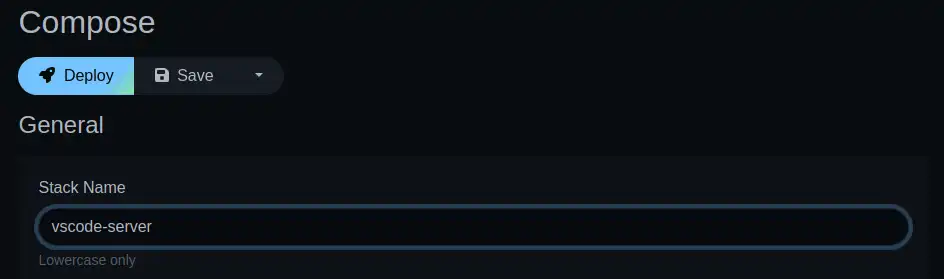

# Saffron

[   ](https://github.com/ivylikethevine/saffron)

## (S)erver (A)s a (F)ile (F)older (R)unning (O)n (N)etwork

...the second half is a backcronym

### What is Saffron?

Saffron is a(n)

1. open sourced
2. homelab deployment
3. annotated notebook
4. self documenting wiki
5. docker compose system

**Saffron is GPL-3.0 open sourced [on github](https://github.com/ivylikethevine/saffron)**

### Saffron is a docker compose deployment of a homelab via (almost entirely) static files

[Why Saffron?](https://ivylikethevine.com/projects/saffron)

I built saffron because I wanted a way to utilize docker compose on a homelab server with easy SVM, configurability, and simple setup.

Read this project's README's as a wiki [here](https://ivylikethevine.github.io/saffron), served via [docsify](https://ivylikethevine.github.io/saffron).

### What does Saffron replace?

Saffron provides 21+ containerized services for a complete homelab:

**Media Management**

- **Sonarr** — TV series automation and management
- **Radarr** — Movie automation and management
- **Lidarr** — Music library automation
- **Bookshelf** — Ebook library automation (maintained Readarr fork)
- **Plex** — Media server and streaming (or self-host streaming)
- **Navidrome** — Music streaming service

**Content Discovery & Search**

- **Prowlarr** — Unified search aggregator for torrent/usenet indexers
- **Flaresolverr** — Search proxy for cloudflare-protected sites
- **Byparr** — Indexer proxy for the *arr ecosystem

**Downloading & Torrenting**

- **qBittorrent** — Torrent client with VPN integration (via gluetun)
- **Bitmagnet** — DHT crawler and torrent indexer (VPN-routed)
- **Soulseek (slskd)** — Direct file sharing client (VPN-routed)

**Backup & Archival**

- **Backrest** — Restic-based backup UI for cloud/local backups

**Monitoring & Admin**

- **Dockge** — Docker Compose management UI (the control center)
- **Dozzle** — Container log viewer
- **Diun** — Notifications when a newer image tag is published
- **Speedtest Tracker** — Internet speed monitoring

**Smart Home & IoT**

- **Home Assistant** — Smart home automation and integration
- **ESPHome** — ESP32 IoT device management
- **Octoprint** — 3D printer monitoring and control
- **Ustreamer** — Lightweight IP camera streaming

**Documentation**

- **Docsify** — Auto-generated wiki from markdown files
- **Heimdall** — Dashboard/homepage for your services
- **Homepage** — Label-driven dashboard that discovers services automatically

**Specialty Services**

- **Gotify** — Push notification server
- **Profilarr** — Quality profile sync for the *arr ecosystem
- **Watch Your LAN** — Network device monitoring

See [stacks/README.md](stacks/README.md) for the complete, up-to-date list.

All while being:

- Zero DNS or networking configuration outside of docker.
- Easily configurable volume mounting via [common.yaml](#common-yaml) and [docker extends](https://docs.docker.com/compose/multiple-compose-files/extends/)
- Easy migration from any existing docker or docker compose deployment.

<!-- [filename](.gitignore ':include :type=code') -->

### Configuration

#### `common.yaml` <a id="common-yaml"></a>

By using a set of base "services"\*\* inside of `saffron/stacks/common.yaml`, we can limit the length of each docker compose file & allow for easy re-use of shared docker configurations, mainly:

1. Consistent PUID/PGID & UMASK - all extended services have shared environment variables.
2. Consistent mount locations (such as media libraries) - library locations only have to be defined once.
3. Consistent localtime - not very important, but nice to have.

On install, saffron copies it's local `stacks/common.yaml.public` file to `stacks/common.yaml`, setting `/data` in all extended containers to the value of `$DATA_DIR` used during setup. This can be changed by editing files directly in the saffron directory. `common.yaml` is set to be ignored by git to prevent committing personal directory paths.

\*\* : These aren't full services since they have no images defined. As such, they can't run alone.

[filename](stacks/common.yaml.public ':include :type=code')

#### Env Files

This project has 2 types of `.env` files:

1. `.env` - this type is natively loaded by dockge, allowing for Web UI editing + templating for paths. This is the place that VPN credentials, etc. should be stored since they will not be committed.
   - if stacks throw errors about undefined variables, make sure to define those variables in the `.env` for that stack.
   - these files are ignored by git, so they can locally hold some credentials (such as VPN logins) + personal folder routing
2. `.env.public` - this holds basic preconfigurations for each container to work and should be changed with caution. They are not available in the Dockge Web UI.

#### Docker Volumes

When editing the DATA_DIR(s), it is often best to have the last part of the host volume match the container volume, such as:

- `/data/television/:/local/library/television` -> Intuitive
- `/data/TV/:/local/library/television` -> Often confusing (at least for me!)

#### Migration Tools

- [composerize](https://github.com/composerize/composerize) - to turn `docker run...` into docker compose yaml (though dockge does have an implementation of this in the UI)
- [decomposerize](https://github.com/composerize/decomposerize) - inverse of above
- [autocompose](https://github.com/Red5d/docker-autocompose) - to turn running containers into docker compose yaml

##### Internal Routing

For configuring docker containers that talk to each other, you can replace `localhost` with the `container_name` of the service to network, as long as both are inside of the same `compose.yaml`. For example, connecting prowlarr & sonarr, you can use `prowlarr:9696` and `sonarr:8989`. If the containers are not in the same stack, this will require a bridge connection. An example of a bridge is included in `servarr` and `torrent`. To connect to `servarr` from `torrent`, `qbittorrentvpn` must use the `servarr_bridge` network.

### Creating a Saffron-Styled compose from Scratch <a id="saffron-example"></a>

Saffron is designed to be extensible. It is more an amalgamation of my experience than a specific software suite. As such, here is a compilation of my advice when creating new docker compose files for use with saffron or similar deployments.

1. Only edit in one mode at a time - Implemented in this repository is a vscode server, which allows for editing of files that dockge does not display in the UI (such as `.env.public`, `.gitignore`, and the dockge `compose.yaml`). Using dockge to edit some files & vscode to edit others can often result in mismatches and confusion. For any operation, pick one tool and use that until you can fully transition to the other tool.
2. Keep secrets in `.env` and double check your commits! An alternative option is [docker secrets](https://docs.docker.com/compose/use-secrets/), but same rules apply. Make sure your commits never contain private keys, etc.
3. Consistent naming - In the homelab space, some of the more advanced features of docker are not as useful and often lead to confusion. Here is an example format for a compose file, with explanations. Also, [here is the compose documentation](https://docs.docker.com/compose/compose-file/05-services/).

- It is often easiest to name the stack after the main service in the compose file.
  

#### stacks/vscode-server/compose.yaml

```yaml
version: '3.8'
services:
  vscode-server:
    # "vscode-server" is the name of our service.
    image: linuxserver/code-server
    # Typically, the service name would be derived from the image name (the part after the "/"). Here, it is different to be easier for human readability since "code-server" is quite vague.
    container_name: vscode-server
    # Usually easiest to keep as exact duplicate of service name.
    restart: on-failure
    # Always remember to define a restart policy.
    ports:
      - 8445:8443
      # The port assignments in saffron are designed to avoid conflicts. host:container is the format, and it is easiest to change host mapping by itself, and not to mess with default port mappings. Some containers require environment variables to change the internal port, so its best to avoid.
    extends:
      file: ../common.yaml
      service: base-settings
      # base-settings: PUID, PGID, UMASK & localtime
      # media-access: base-settings + volume mounting $DATA_DIR(s)
    volumes:
      - /containers/vscode-server/config:/config
      # Again, usually easiest to follow /containers/container_name/folder:/folder for consistency & clarity.
networks: {}
```

#### To Install \* Deploy

In depth instructions, including prerequisites [here](resources/README.md).

Requires: git, docker, docker compose

Tested on: Linux Mint, Ubuntu, and Debian

```bash
# Grab saffron (either http or ssh)
git clone https://github.com/ivylikethevine/saffron.git # http, works with no SSH key
git clone git@github.com:ivylikethevine/saffron.git # ssh
cd saffron/resources

# Make directories with correct permssions, create common.yaml, & start dockge
./install-saffron.sh
```

Then visit `http://localhost:5001` or `http://<hostname>.local:5001` to start and stop individual stacks via the [Dockge](https://github.com/louislam/dockge) interface. Dockge is a Web UI to manage & control docker containers. As opposed to portainer, the user maintains direct and full control of the [compose](https://docs.docker.com/compose/) [yaml](https://learnxinyminutes.com/docs/yaml/) files.

If a service isn't on here yet, feel free to add it! Most of these are very simple applications of the excellent [linuxserver docker images](https://docs.linuxserver.io/images/). See creating a [saffron-styled compose](#saffron-example) for more detail on the format of `compose.yaml`. There are also the [official docker hub images](https://hub.docker.com/u/library).

I've also made stacks using Lissy93's well maintained [portainer template repo](https://github.com/Lissy93/portainer-templates), although this is slightly different than working from raw compose files.

### Important Paths

1. `/containers/` - stores individual generated configs, db files, etc.
   - This is not a perfect separation, since some containers will use config for "data" (such as torrent clients using it as a default download location)
2. `stacks/` in the checkout - all stacks & services' compose files
3. `$DATA_DIR` - where bulk files are stored (configured during setup) See [common.yaml](#common-yaml) for more infromation.

### Roadmap

Potential improvements, upgrades, and nice-to-haves, roughly ordered by
impact vs. effort. This is a planning document, not a commitment — pick
items up as they become relevant.

#### ✓ Completed (2026-08-16)

These have been implemented:

- **Pin image versions** — All floating `:latest`/`:develop`/`:nightly` tags pinned to specific releases (profilarr 2.1.0, byparr 3.0.4, prowlarr nightly-2.6.2.5548-ls10, homeassistant 2026.8.0). `pull_policy` flipped to `missing` for pinned services. See commit 532cba4.
- **Add healthchecks** — Added HTTP healthcheck to qbittorrent (wget on port 8080). Converted portcheck's `depends_on` from list to mapping form with `condition: service_healthy`.
- **Add resource limits** — Added `deploy.resources.limits.memory` to 24 services across 13 stacks (512M for medium-weight, 256M for lightweight UI, 1G for browser-backed, 128M for portcheck). Memory-only per initial scope.
- **Reconcile `pull_policy`** — All pinned services now use `pull_policy: missing`; floating-tag services (portcheck) remain `always`.
- **Network topology diagram** — Added Mermaid diagram to CLAUDE.md showing servarr_bridge, VPN-routed services (bitmagnet-gluetun, qbittorrentvpn), and host-mode services. Created `resources/generate-topology.py` to regenerate diagram programmatically. See commit 700d2fe.
- **Multi-arch verification in CI** — Added `multi-arch-verify` job to `.github/workflows/compose-validate.yml` that checks ARM64 image availability for linuxserver, qmcgaw, and GHCR images via Docker Hub registry API. Verifies all multi-arch images support both linux/amd64 and linux/arm64v8. See commit ebf07f5.

- **Automated dependency updates** — Added `.github/dependabot.yml`
  (`github-actions` ecosystem, monthly, grouped) plus
  `.github/workflows/image-freshness.yml` and
  `resources/check-image-freshness.py`, which compare every pinned `image:`
  tag against upstream and report into the CI job summary. Runs monthly and
  on demand; always exits 0, since a stale upstream release is information,
  not a build failure.

  Two constraints worth remembering, both learned the hard way:

  1. **Dependabot cannot watch these files.** Its `docker` ecosystem only
     matches `Dockerfile` and `docker-compose.yml`/`.yaml`, and every stack
     here uses `compose.yaml`. A `docker` block would not error — it would
     just silently never open a PR. Hence the custom checker.
  2. **GHCR's `tags/list` returns tags oldest-first.** Page 1 of
     home-assistant is 2021 dev builds; the current release sits thousands
     of pages deep, so forward pagination finds old tags, not new ones. The
     script uses the GitHub releases API (newest-first) _merged_ with a
     bounded tag-list walk, because the releases API alone lags the registry
     — bitmagnet ships a `v0.10.1` image tag with no matching release.

  Tag comparison is shape-aware (`nightly-…-ls10` is only compared against
  the same shape) and major-version bumps are reported separately from
  routine ones, so a Postgres 16 → 18 jump is never presented as a pin edit.

#### ✓ Completed (2026-10-17)

- **Routine pin bumps** from `check-image-freshness.py`, all 17 non-major
  ones in one batch.
- **Log rotation and `no-new-privileges`** on `base-settings` in
  `common.yaml.public` (10m × 3 json-file), repeated directly on the six
  services that don't extend it: bitmagnet's three, ustreamer, watchyourlan
  and dockge.
- **Homepage stack** on port 82 beside heimdall, with the docker socket
  mounted read-only for label discovery.
- **CI: `.env.public` completeness and `stacks/README.md` index checks.**
- **Consistency pass**: every floating tag pinned (bitmagnet, byparr,
  dockge), obsolete `version:` keys dropped, retired readarr swapped for
  bookshelf (data stays in `/containers/readarr`), stale bazarr docs
  removed, watchtower replaced by diun, healthchecks on every service with
  a verified binary, `/etc/localtime` as the one timezone source.
- **Template consolidation**: `restart`, `pull_policy`, hardening, log
  rotation, healthcheck timings and the timezone mount live in
  `base-settings` and every service extends it. The root compose and the
  two stacks that need the checkout path read it from `PWD`/`SAFFRON_DIR`
  instead of `/home/$USER/saffron`. The pre-commit hook is linked by the
  install script. The multi-arch CI job, which only ever checked ghcr images
  and skipped those unconditionally, and the Jekyll build of a docsify site
  are gone.
- **`homepage.*` labels on all 26 UI services**, grouped Media, Media
  Management, Indexing, Downloads, Home and Infrastructure; links use
  `HOMEPAGE_HOST`, passed down from dockge.
- **dozzle v10 → v11.** No config changes; everyone is signed out once.

#### Now (high impact, low-to-medium effort)

- **Postgres major bump**, its own piece of work:
  - **postgres `16.15-alpine → 18.6-alpine`** for bitmagnet needs a
    `pg_dumpall` from the old container and a restore into the new one;
    confirm bitmagnet v0.10.1 supports 18 first.

#### Next (real gaps, more design work)

- **Reverse proxy + TLS.** Nothing in the repo terminates TLS or provides a
  single entry point; every service is its own `host:port`. A `traefik` or
  `caddy` stack with automatic Let's Encrypt (or self-signed for pure-LAN
  use) would let services be reached at `sonarr.saffron.local` instead of
  `:8989`, and is the prerequisite for safely exposing anything beyond the
  LAN.
- **Auth in front of unauthenticated UIs.** Dockge, Dozzle, and several
  other UIs have no login by default — fine for a single trusted LAN, risky
  the moment the host is reachable from anywhere else (guest wifi, VPN
  clients, etc.). Pair with the reverse-proxy work above: forward-auth or
  basic-auth at the proxy layer covers everything at once instead of
  per-service.
- **Secrets management beyond `.env`.** Current model (`.env.public`
  template → user-created `.env`, gitignored) is fine for solo use. If this
  ever becomes a team/multi-host setup, revisit git-crypt or a small
  secrets store rather than hand-copying `.env` files during migration.
- **Smoke-test the CI workflow, not just syntax.** `compose-validate.yml`
  currently checks YAML validity, README presence, and a few string
  patterns — never actually starts a container. A follow-up job that spins
  up one or two low-risk stacks (`docker compose up -d && curl healthcheck`)
  would catch breakage the static checks can't.

#### Later (bigger investments, optional)

- **Backup restore drills.** `backrest` is documented for backups, but
  nothing verifies a restore actually works. A periodic (manual or
  scripted) "restore into a scratch dir and diff" check would turn "we have
  backups" into "we know the backups work."
- **One shared VPN stack.** torrent and bitmagnet each run their own
  gluetun. A single `vpn` stack with consumers on
  `network_mode: container:gluetun` halves credentials and config, at the
  cost of a cross-stack startup-order dependency.
- **ARM64 verification.** Nothing checks that pinned images publish an
  arm64 manifest. Only needed if Saffron runs on ARM hardware; the check
  belongs in `check-image-freshness.py`, which already talks to both
  registries.

#### Nice-to-haves (low priority, quality-of-life)

- **`docker compose config` lint in the pre-commit hook**, not just CI —
  catches YAML mistakes before they're even committed, not just before
  merge.
- **Screenshots for the 9 newly-documented stacks.** backrest, bitmagnet,
  gotify, indexing, lidarr, navidrome, profilarr, slskd, and watchyourlan
  currently skip the "WebUI Dashboard" section since no screenshot exists
  in `resources/screenshots/` — cosmetic, but matches the pattern the rest
  of the wiki uses.

#### Candidate services

- **Media**: Jellyfin (open alternative to Plex), Tautulli (Plex stats),
  Audiobookshelf, Unpackerr and Cleanuparr (arr queue hygiene), Recyclarr
  if profilarr proves heavy.
- **Ops**: Uptime Kuma (same author as Dockge), Beszel (lightweight host and
  container metrics), Scrutiny (disk SMART health, pairs with backrest).
- **Network and auth**: Caddy with Tinyauth or Authelia for the proxy and
  login items above, Pi-hole or AdGuard Home, Vaultwarden.
- **Photos**: Immich.

#### Explicitly out of scope (for now)

- **Orchestration beyond Compose** (Kubernetes, Nomad, Swarm). Saffron's
  whole value proposition is "static YAML, no cluster to operate." Revisit
  only if running across multiple physical hosts becomes a real need.
- **Built-in image signing/verification.** Worth knowing about but adds
  real friction for a homelab; not worth doing
  until there's a specific threat this is defending against.

### AI Usage

Heavily inspired by
[Dictionarry/Profilarr's AI Transparency Statement](https://v2.dictionarry.dev/ai-transparency).

This started as code written entirely by
[me](https://github.com/ivylikethevine), but I have used generative AI to write
update parts of it. All of the code here is my _responsibility_ regardless: AI
is a tool, not an owner of a project. I have personally understood, reviewed,
and approved all of the AI-generated code in this repository, and **mainline
releases** carry the same accountability to me as anything I write and publish
myself.
