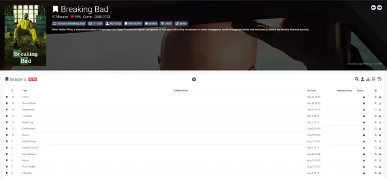
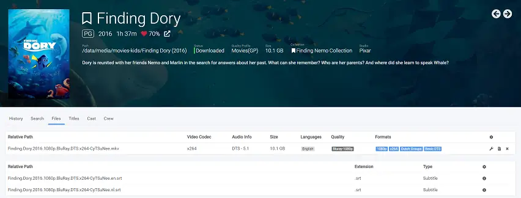
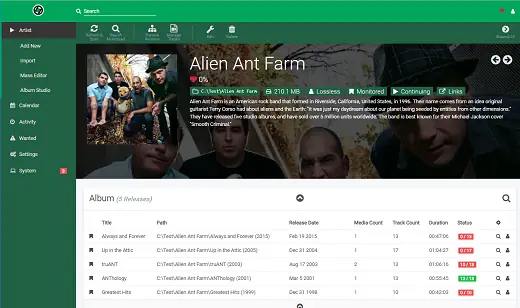
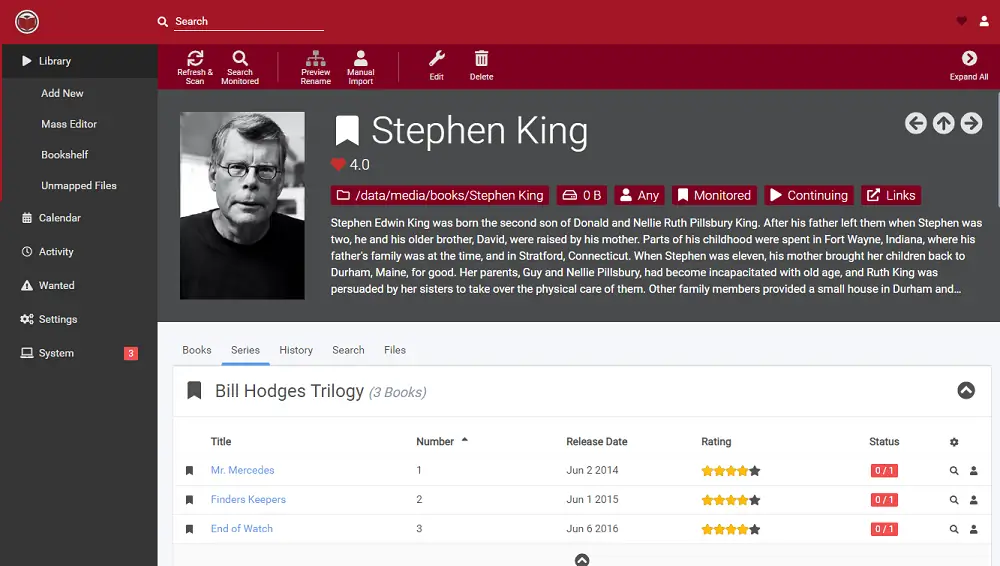

# Servarr

Media library systems.

<https://wiki.servarr.com/docker-guide>

## Related Stacks

- **[indexing](../indexing/README.md)** — Prowlarr and Flaresolverr for search integration
- **[lidarr](../lidarr/README.md)** — Standalone music library manager
- **[torrent](../torrent/README.md)** — Torrent client for automated downloads

# Sonarr

TV library manager.

<https://github.com/Sonarr/Sonarr>

<https://wiki.servarr.com/en/sonarr>

<https://docs.linuxserver.io/images/docker-sonarr/>

<https://github.com/linuxserver/docker-sonarr>

<https://hub.docker.com/r/linuxserver/sonarr>

## Architecture Compatibility

 

### WebUI Dashboard

# Radarr

Movie library manager.

<https://github.com/Radarr/Radarr>

<https://wiki.servarr.com/en/radarr>

<https://docs.linuxserver.io/images/docker-radarr/>

<https://github.com/linuxserver/docker-radarr>

<https://hub.docker.com/r/linuxserver/radarr>

## Architecture Compatibility

 

### WebUI Dashboard

# Lidarr

Music library manager.

<https://github.com/Lidarr/Lidarr>

<https://wiki.servarr.com/en/lidarr>

<https://docs.linuxserver.io/images/docker-lidarr/>

<https://github.com/linuxserver/docker-lidarr>

<https://hub.docker.com/r/linuxserver/lidarr>

## Architecture Compatibility

 

### WebUI Dashboard

# Bookshelf

Ebook library manager, the maintained fork of the retired Readarr. The
`softcover` image keeps Readarr's Goodreads metadata, so an existing Readarr
config directory in `/containers/readarr` keeps working in place. The
`hardcover` image has better metadata but needs a fresh database.

<https://github.com/pennydreadful/Bookshelf>

<https://github.com/pennydreadful/Bookshelf/pkgs/container/bookshelf>

### WebUI Dashboard

#### `compose.yaml`

[filename](compose.yaml ':include :type=code')